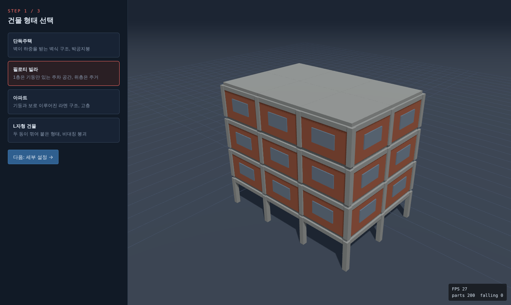
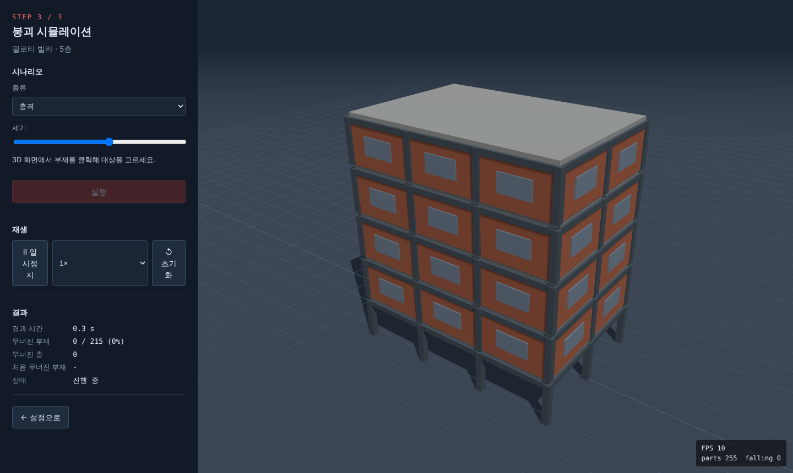
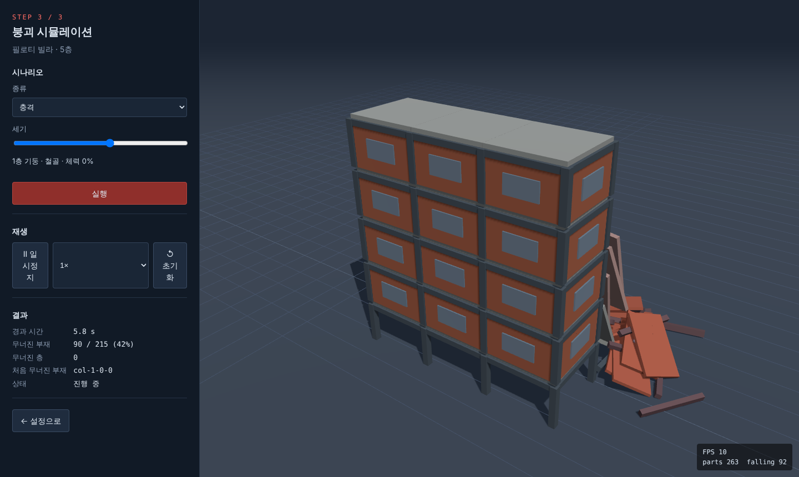
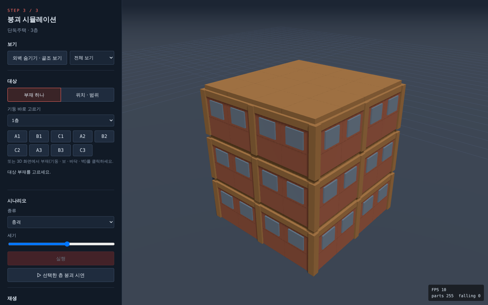
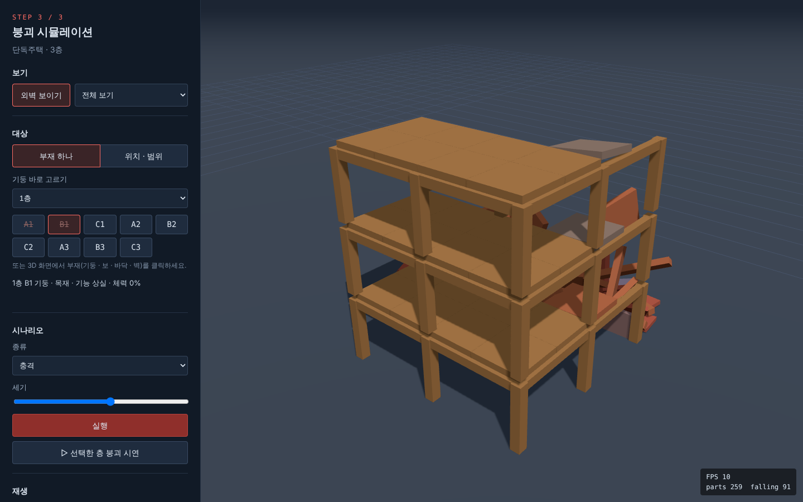
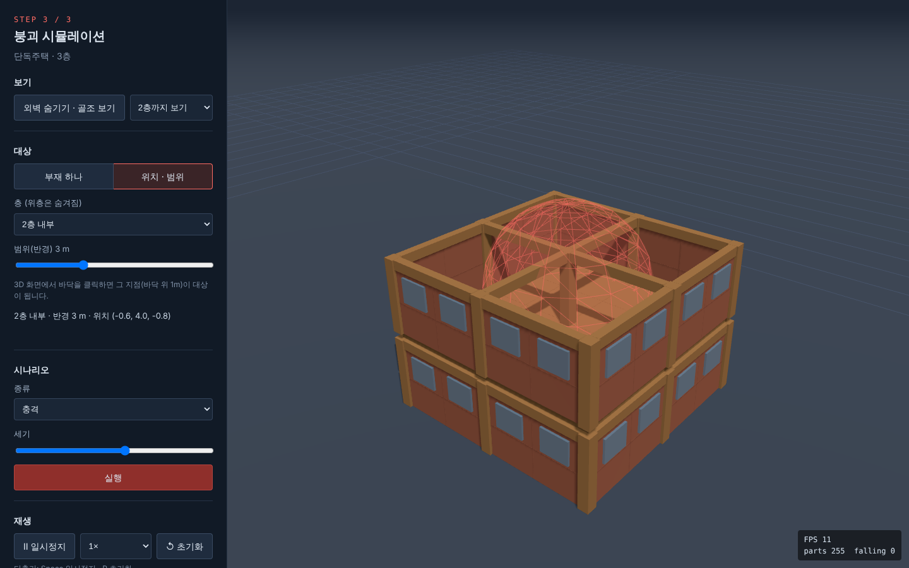
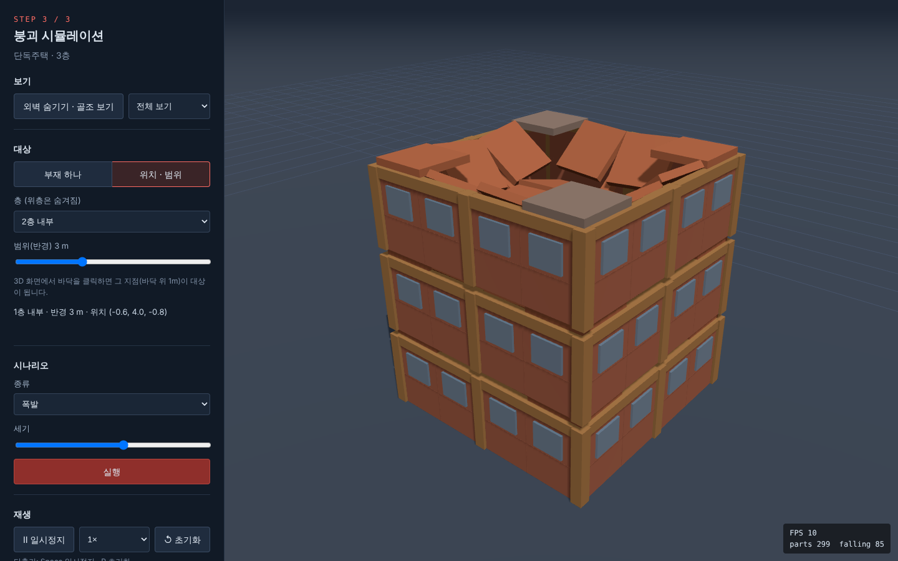
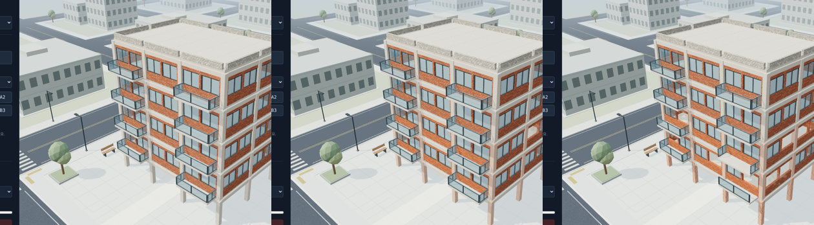

# 인수인계 기록

단계가 끝날 때마다 **맨 아래에** 아래 양식으로 추가합니다. 스크린샷은 `docs/handoff/` 에 넣습니다.

```md
## N단계 · 담당 → 완료 (날짜 시각)

- 완료한 것:
- 실행 · 확인 방법:
- 바꾼 약속 (추가한 필드 · 이벤트):
- 다음 사람이 알아야 할 것:
- 알려진 문제 · 못 한 것:
- 스크린샷:
```

---

## 0단계 · 베이스 (통합 담당) → 완료 (11/1 일)

### 완료한 것

- Vite + Three.js 0.180 + cannon-es 0.20 프로젝트, 코드 포맷(Prettier) · 줄바꿈(LF) 규칙
- 데이터 약속: `core/types.js`, `core/events.js`, `data/ids.js` (설명은 `docs/CONTRACTS.md`)
- 공용 코어: 이벤트 버스, 상태 저장소, 고정 시간 루프(1/60초), 개발용 URL 옵션
- 모든 모듈의 **임시 버전** — 처음부터 끝까지 동작함
  - A: 격자 골조 생성기(기둥 · 보 · 바닥판 · 바깥 벽 · 창문), 재료 색, 조명 · 그림자, 구 모양 이펙트
  - B: 구조 판단(받쳐주는 부재의 절반 초과가 살아 있어야 버팀), 기능 상실 시 조각 분리, 물리 낙하 · 충돌 · 정지 판정, 시나리오 4종(간단 버전), 결과 계산
  - C: 3단계 화면(버튼 · 드롭다운), 부재 클릭 · 마우스 올림 강조, 카메라 회전 · 자동 맞춤, 재생 제어, 결과 숫자

### 실행 · 확인 방법

```bash
npm install
npm run dev
```

- 필로티 빌라 → 다음 → 시뮬레이션 시작 → 1층 기둥 클릭 → 실행을 두 번 누르면 기둥이 부서짐
- 같은 줄의 1층 기둥을 하나 더 부수면 그 위가 연쇄로 무너짐
- 바로 시뮬레이션 화면: `/?type=piloti&floors=4&screen=simulate&debug=1`

### 다음 사람(A)이 알아야 할 것

- 수정 범위: `src/build/`, `src/render/`, `src/data/materialLooks.js`, `public/textures/`
- 형태별 파일(`build/types/*.js`)에 `TODO(A)` 가 적혀 있습니다. 지금은 네 형태 모두 `build/frame.js` 의 격자 골조를 씁니다.
- 부재는 반드시 `createPart()` 로 만들고, `supportedBy` 를 정확히 채워야 B의 붕괴 판단이 동작합니다. (`frame.js` 맨 위 주석에 규칙 정리)
- 박공지붕처럼 기울어진 부재는 `quaternion` 으로 회전을 넣으면 됩니다.
- 렌더러는 부재 하나당 메시 하나(재질도 각각)인 단순한 방식이라, 부재가 많으면 느립니다 → `InstancedMesh` 로 개선 권장.

### 알려진 문제 · 못 한 것

- **성능**: 아파트 10층(약 560개 부재)을 크게 무너뜨리면 물리 계산이 한 단계에 15ms 정도 걸려 느려짐 → B 단계에서 최적화 필요 (`npm run bench -- apartment 10` 으로 측정)
- 떨어지는 부재가 서 있는 부재를 부숴 내리는 "무게에 따른 파괴"는 아직 없음 (B의 `simulation.js` TODO)
- 지진은 실제로 땅이 흔들리지 않고 1층에 무작위 피해만 줌, 화재 불꽃 표현 없음
- 화면은 기능 확인용 최소 디자인

### 스크린샷

| 형태 선택                      | 시뮬레이션                       | 붕괴                             |
| ------------------------------ | -------------------------------- | -------------------------------- |
|  |  |  |

---

## 0단계 보강 · 베이스 (통합 담당) → 완료 (11/1 일)

첫 실행 후 나온 문제("부품이 너무 크다", "위층 천장이 안 무너진다", "프로포절 데모보다 기능이 적다")를 반영했습니다.

### 완료한 것

- **부재 세분화**: 바닥판은 한 칸을 2×2 조각, 바깥 벽은 한 면을 가로 2 × 세로 2 패널, 창문은 위쪽 패널마다
- **하중 경로 재정의**: 바닥판 조각 → 보 → 기둥 → 아래층 기둥 → 땅. 기둥이 무너지면 거기 걸린 보와 그 위 바닥판이 따라 떨어지고, 이웃 칸은 버팀 (규칙은 `docs/CONTRACTS.md` 2장)
- **위치 · 범위 대상**: 시나리오 대상이 `{ kind:'part' }` 또는 `{ kind:'area', position, radius }`. 건물이 멀쩡해도 단면 보기로 내부를 보고 바닥을 클릭해 폭발 · 충격 · 화재 위치를 지정
- **프로포절 데모 기능 회복**: 외벽 숨기기, 층 · 기둥 버튼 선택, 이벤트 로그, 상태 색 범례, 선택한 층 붕괴 시연, 단축키(Space · R)
- **렌더러 성능**: 같은 재료끼리 `InstancedMesh` 로 묶어 그림 → 부재 900개에서도 부드러움
- **결과 버그 수정**: 창문 같은 장식 부재가 "처음 무너진 부재"로 잡히지 않음
- 물리 계산이 무거울 때 화면이 멈추지 않고 느리게 재생되도록 루프 보호 (`core/loop.js`)
- 아파트 최대 8층, L자형 최대 5층으로 조정 (성능)

### 실행 · 확인 방법

- 단독주택 3층 → 시뮬레이션 → **▷ 선택한 층 붕괴 시연**: A1 · B1 기둥이 차례로 부서지고 그 칸의 보 · 바닥판 · 벽이 떨어짐
- **위치 · 범위** → 층 `2층 내부` → 바닥 클릭 → 시나리오 `폭발` → 실행: 2층 내부에서 폭발
- 화면 없이 물리 속도 측정: `npm run bench -- piloti 5`

### 다음 사람(A)이 알아야 할 것

- 렌더러는 이제 **재료별 InstancedMesh** 입니다 (`render/partMeshes.js`). 색은 인스턴스 색(`setColorAt`)으로 바뀌고, 숨김은 크기 0으로 처리합니다.
  텍스처를 붙일 때는 재료별 `MeshStandardMaterial` 에 `map` 을 넣으면 되고, 부재마다 크기가 달라 텍스처가 늘어나 보이면 `onBeforeCompile` 로 월드 좌표 기반 UV(삼면 투영)를 쓰는 걸 추천합니다.
- 형태별 모양은 `build/types/*.js`. 지금은 모두 `build/frame.js` 의 격자 골조입니다. 박공지붕 같은 기울어진 부재는 `quaternion` 으로 회전을 넣고, **supportedBy 를 반드시 채워 주세요**.
- 상태 색은 `data/stateColors.js` (공용) — 바꾸고 싶으면 통합 담당에게.
- 대상 표시(반투명 구)는 `scene.js` 의 `setTargetMarker` 입니다. 더 예쁘게 다듬어도 됩니다.

### 다음다음 사람(B)을 위한 메모

- **천장이 휘는 표현**: 강체 상자는 휘지 않으므로, 바닥판 조각들을 cannon-es 의 `HingeConstraint`(또는 `PointToPointConstraint`)로 서로 이어 두고,
  지지를 잃은 조각만 움직이게 하면 한쪽이 처지며 꺾이는 모습이 나옵니다. 일정 힘 이상이면 연결을 끊어(`world.removeConstraint`) 떨어지게 하세요.
- **무게에 따른 아래층 파괴**: `simulation.js` 의 TODO 위치. 떨어지는 부재의 `collide` 이벤트에서 충격 속도 × 질량으로 아래 부재에 `ctx.damage()`.
- **성능**: 아파트 8층에서 크게 무너지면 한 단계 20ms 이상 (`npm run bench -- apartment 8`). 멈춘 잔해 정적 전환, 작은 조각은 물리 없이, 물리 30Hz 등 검토.

### 알려진 문제 · 못 한 것

- 지진은 아직 땅이 흔들리지 않음, 화재 불꽃 표현 없음 (B · A)
- 재질은 단색, 형태별 실제 모양 없음 (A)
- 화면 디자인은 기능 위주 (C)

### 스크린샷

| 시작 화면                         | 붕괴 시연                     | 위치 지정 (2층 단면)               | 2층 내부 폭발                           |
| --------------------------------- | ----------------------------- | ---------------------------------- | --------------------------------------- |
|  |  |  |  |

---

## 2단계 · B (시뮬레이션) → 완료 (11/9 월)

### 완료한 것

- **B-1 무게에 따른 파괴**: 떨어진 부재의 충돌 에너지(½mv², 반발 계수 · 재료 흡수 능력 · 충돌 위치 반영)와 쌓인 잔해 무게(KDS 하중조합 기준 내력)로 아래 부재가 부서짐
- **B-2 A가 넘긴 버그**: 기울어진 부재의 조각 위치 · 거리 계산에 회전 반영, 화재 · 지진 마지막 단계 지지 판단 누락 수정
- **B-3 유리 깨짐**: 유리는 강체 없이 바로 깨짐 + `IMPACT kind:'glass'` → 필로티 5층 24.7 → 10.0 ms/단계
- **B-4 재료 보정**: 밀도 · 조각 수 · 내화성을 실제 기준으로 (강도 값은 유지)
- **B-5 지진**: 지면 · 건물이 실제로 흔들림(높이에 비례), 층 질량 × 높이 기반 등가정적 지진력으로 층별 피해, 필로티 1층 연약층 표현, 끝나면 원래 위치로 복구
- **B-6 결과 값**: `collapseTime`, `floorDamage`, `damageByCause`

자세한 식 · 근거 · 측정값은 `src/sim/B_NOTES.md`.

### 실행 · 확인 방법

- 필로티 5층 → 시뮬레이션 → 지진, 세기 0.7 이상: 건물이 흔들리고 유리가 깨지다가 1층 기둥이 부서지며 내려앉음
- 철근콘크리트 아파트 8층 → 지진 세기 1: 흔들리지만 거의 버팀
- 화면 없이: `node scripts/compare-quake.mjs piloti 5 1`, `node scripts/compare-crush.mjs piloti 5 4`

### 바꾼 약속 (추가한 필드 · 이벤트)

- `SimResults`: `collapseTime`, `floorDamage`, `damageByCause` (`docs/CONTRACTS.md` 4장, `core/types.js`)
- `IMPACT` 이벤트 kind 에 `'glass'` 추가 (`core/events.js`)
- `materialPhysics` 에 `shearColumn`, `shearWall` (지진용) 추가

### 다음 사람이 알아야 할 것

- **A**: `IMPACT kind:'glass'` 에 유리 파편(반짝이는 작은 판 파티클)을 그려 주면 좋습니다. 지금은 먼지로 대체됩니다. 지진 동안 화면(카메라) 흔들림을 넣으면 더 실감 납니다 — 지진 중인지는 `SCENARIO_RUN` 의 `type:'earthquake'` 후 8초
- **C**: 결과 화면에 새 결과 값 3종을 보여 주세요 (층별 피해 막대, 원인별 비율 막대 등). 지진 중에는 서 있는 부재의 `position` 이 매 단계 바뀝니다
- 지진 세기 기준: 세기 1 = 최대 지반 가속도 0.5 g

### 알려진 문제 · 못 한 것

- 바닥판이 휘는 표현은 향후 과제
- 아파트 8층 전체 붕괴는 여전히 무거움 (평균 44 ms/단계) — 시연은 5층 이하 권장
- 지진은 층 단위 근사라 비틀림(L자형 평면) 피해는 없음

### 스크린샷

| 필로티 5층 지진 (세기 0.7): 흔들림 → 유리 깨짐 · 1층 기둥 손상 → 1층 기둥 파괴 |
| ------------------------------------------------------------------------------ |
|                                             |
